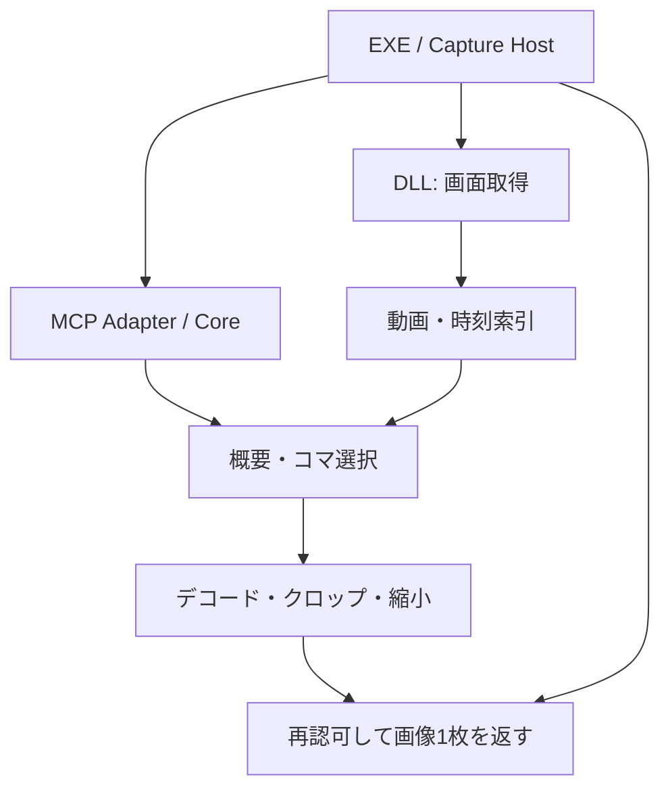
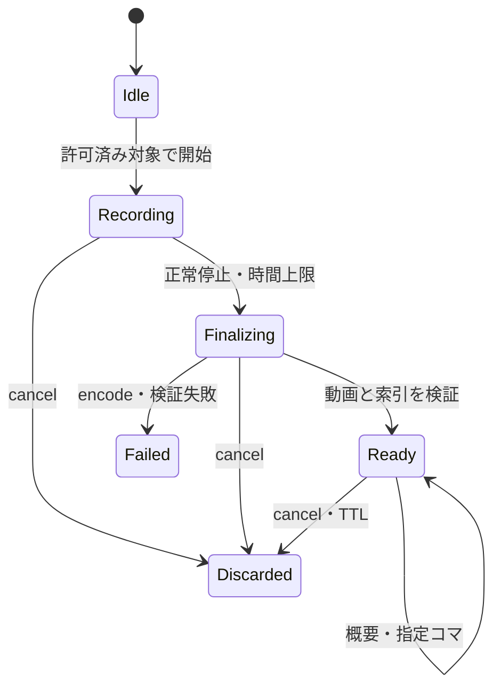

# FLAMORIS Capture 基本設計 v0.1

**更新:** 2026-10-22 / **状態:** 動画観測の設計ベースライン。単一ウィンドウ静止画は[ADR 0001](decisions/0001-one-window-screenshot.md)に従う初期ソース実装あり。実Windows受け入れ・リリースとは別。動画API・数値は設計提案。

## 1. 目的と成功条件

人間は動画を再生し、AIは必要なコマを選んで観測する。同じ録画資産を利用し、録画取得とMCPへの開示を分離する。標準のAIフローで動画全体や全フレームを自動送信しない。

成功条件は、Cutworkの操作を短く録画した後、AIが概要とコマ一覧から表示崩れの区間を絞り、指定コマ・操作イベント・アプリ側状態を照合できること。映像と操作の一致は調査の証拠であり、因果関係を保証しない。

### 標準の観測手順

1. EXEで人間が対象を選び、撮影とMCP開示を許可する。
2. DLLが静止画または上限付き動画を取得。動画本体はCapture内で保持する。
3. AIが録画概要を問い合わせる。この応答に画像・動画は含めない。
4. 例えば30秒から0、3、6、…、27秒の10コマを選び、一覧画像を1枚だけ取得する。
5. 気になる12秒付近のコマを時刻・番号で指定。必要な部分だけ高解像度で再取得する。
6. 操作記録が許可されていれば、同じ区間のイベントと前後のコマを確認する。

## 2. スコープと責務

| 要素 | 所有するもの | 他へ任せるもの |
|---|---|---|
| Capture DLL | 対象取得、時刻正規化、動画エンコード/デコード、索引、画像化、差分 | UI、接続認証、アプリ編集 |
| Capture EXE / Host | 対象選択、許可、録画と資産のライフサイクル、予算、ローカルプレビュー | 他アプリの内部状態 |
| MCP Adapter | 型付き要求、上限検査、同じHostへの問い合わせ、画像/メタデータの開示 | 独立した録画セッション、独自トランスポート |
| MCP Core | 接続、能力付与、失効、要求寿命、標準画像応答 | Capture固有の録画・コマ定義 |
| Cutwork / 2D / Kachinco | マスク、リグ、タイムライン、revisionなど内部状態 | 共通のWindows画面取得 |

DLLを組み込む製品も同等のHost責務を実装する。単独EXEはFLAMORIS以外のソフトも対象にできる。入力再生、動画編集、HowTo生成、任意ファイルのインポート、OCR、異常判定AIは初期スコープ外。



WGCを取得バックエンドの第一候補、Media Foundationを録画・デコードの第一評価候補とする。コーデック、OS最小版、配布依存関係はPoCで確定する。バックエンド非対応時に画面全体へ自動フォールバックしない。

## 3. 撮影対象と座標

対象は`window` / `region` / `monitor`。初期実装は単一ウィンドウから始める。対象識別はHost発行の`targetId`とプロセス/ウィンドウ実体の寿命で行い、HWND単独を永続IDにしない。

- 矩形は選択モニター内に限定し、モニターをまたぐ矩形はv0.1では非対応。
- 元フレーム座標`source_px`は撮影対象の左上を(0,0)とする物理ピクセル。ROIは`x,y,width,height`の半開矩形で、はみ出しは拒否する。
- `desktopOriginPx`（負値あり）、DPI、対象サイズ、ROI、出力サイズ、倍率、`geometryId`を記録する。DIPの操作イベントは記録時点の変換情報を保持する。
- ウィンドウのサイズ変更は新しいgeometry区間に分ける。動画も固定サイズのsegmentに分割し、各segment内のPTSと録画時刻の対応を保持する。
- ROIの再利用先でサイズが変わっていたら再検証し、黙ってクランプしない。比較画像は同じgeometry/ROI/変換のみ許可する。
- 黒画像が来ただけで保護コンテンツと断定しない。取得不能、最小化、保護、欠落など、バックエンドが把握できる状態と未知を区別する。

## 4. 時刻・コマ番号・索引

### 録画時間軸

録画開始時のmonotonic clockを0とし、経過時間は停止まで進む。停止中の穴やサイズ変更による欠落を詰めない。v0.1は一時停止/再開を提供せず、再録画は新しい`recordingId`になる。

MCPの時刻指定は録画相対の整数ミリ秒`timeMs`。内部は100ns整数tickで保持する（1ms = 10,000 tick）。UTCは人間向け開始日時とログの補助に限定し、コマ選択に使わない。異なるマシンのアプリログは明示的な時計対応と誤差がなければ同期済みと扱わない。

WGCの`SystemRelativeTime`はコンポジタ描画時のQPC時刻として文書化されている。Hostのイベント時計との対応を測定し、`clockMapping`と`syncErrorBoundMs`を保存する。精度不明なら値をnullとし、0ms精度を装わない。

### コマの定義

`frameIndex`は**最終化された動画の表示順で0始まり**の連番。録画内のsegmentをまたいで一意。デコード順、取得試行番号、`time × 公称FPS`とは区別する。エンコーダが生成した重複フレームも表示フレームとして索引化し、元取得コマとの対応が不明なら`sourceFrameId=null`とする。

索引レコードは最低限`frameIndex, segmentId, ptsTicks, captureTimeTicks|null, geometryId, sourceFrameId|null`を持つ。動画の表示時間から録画時間への写像を保存し、並べ替え・CFR/VFR・ドロップ・複製を追跡する。`recordedFrameCount`と`capturedFrameCount`を別にし、不明な数値はnull。公称FPSからフレーム総数を推測しない。

### 選択規則

- セレクタは`timeMs`と`frameIndex`のどちらか一方。両指定、負値、範囲外、整数オーバーフローは`invalid_request`。
- 時刻指定は`nearest`（既定）/`at_or_before`/`at_or_after`。同距離なら早いコマ、同時刻なら小さいindexを選ぶ。
- 時刻差の許容値`toleranceMs`は既定100ms、最大1000ms。超えたら`frame_unavailable`。欠落区間内の要求は近隣コマで隠さず同エラーにする。
- 応答に要求時刻、実際の`actualTimeTicks`、`frameIndex`、`deltaMs`、geometry、欠落情報を必ず含める。ミリ秒丸め前の実時刻も残す。
- 番号指定はその表示フレームのみ。対応コマを取得できなければ失敗し、隣の番号に置き換えない。
- 任意時刻へのseekだけで正確なコマが返ると仮定しない。先行キーフレームからデコードし、PTSと索引を照合して選択する。時間/デコード予算内で見つからなければ`timeout` / `frame_unavailable`。

## 5. データ構造 v0.1

以下は製品DTOの設計。Coreの外側に別のMCP結果エンベロープを作らず、`McpResult.Value`へ格納する。

| DTO | 主なフィールド |
|---|---|
| ObservationContext | `schemaVersion, sessionId, targetId, permissionEpoch` |
| RecordingSummary | `recordingId, state, durationMs, nominalFps, capturedFrameCount, recordedFrameCount, eventTraceState, eventCount, gaps, geometries, supportedQueries, expiresAt` |
| FrameDescriptor | `frameIndex, actualTimeTicks, segmentId, geometryId, sourceFrameId, sourceWidth, sourceHeight, gapFlags` |
| Selection | `selectionId, recordingId, assetRevision, expiresAt, items[]` |
| SelectionItem | `itemId, requestedSelector, status, frameDescriptor|null, error|null` |
| ImageDescriptor | `mimeType, byteLength, sha256, outputWidth, outputHeight, roi, scale, quality, cursorMode, annotations` |
| TraceEvent | `eventId, timeTicks, kind, geometryId, coordinateSpace, payload, timestampSource, uncertaintyMs` |

`eventTraceState`は`not_recorded` / `recorded` / `partial`。未記録を「イベント0件」と区別する。summaryの巨大なgaps/geometriesは件数と有界ページに分ける。`supportedQueries`は実装・資産ごとの利用可否を返し、未実装ツールは登録しない。

保存bundleは`manifest.json`（版、時間軸、対象、geometry、segment一覧、期限、サイズ、hash）、`video-*.mp4`、`frames.jsonl`（索引）、任意の`events.jsonl`を基本とする。形式はPoCの結果に合わせて変更可能。MCPにはパスや任意URLを渡さず、不透明なIDのみ公開する。

## 6. MCP操作契約

**現実装は `capture.session.get` と `capture.screenshot.get` のみ。** これ以外は予定のツール名で、登録・実装なし。静止画の実際の引数・上限・接続方法は[SETUP](SETUP.md)と[ADR 0001](decisions/0001-one-window-screenshot.md)を参照。 全要求はCoreの認可/RequestGuardに加えて現在の`sessionId`に結び付ける。recording/selection/eventのIDはそのsession内だけで有効。JSONスキーマは閉じたDTOとし、未知フィールド、NaN、過大配列を拒否する。

| Tool | 主入力（共通sessionIdは省略） | 結果 / 副作用 |
|---|---|---|
| `capture.session.get` | なし | 現在の対象、状態、利用可能機能、実効上限。対象列挙や選択変更はしない |
| `capture.screenshot.get` | `roi?, maxEdge?, format?, requireExactSize?` | 許可対象の新しい静止画1枚とメタデータ |
| `capture.recording.start` | `durationMs, fps, maxEdge` | 録画ID。重複開始はbusy。許可範囲内でのみ開始 |
| `capture.recording.status` | `recordingId` | 状態と有界の進捗。画像なし |
| `capture.recording.stop` | `recordingId` | 非同期最終化へ移行。同じ録画の再停止は冪等 |
| `capture.recording.cancel` | `recordingId` | 録画破棄、派生資産無効化。既に破棄済みなら冪等 |
| `capture.recording.summary` | `recordingId, cursor?` | 概要/詳細ページのみ。画像・動画なし |
| `capture.frame.get` | `recordingId, selector, roi?, maxEdge?, format?, requireExactSize?` | 指定コマ1枚と実時刻等。常に画像は最大1枚 |
| `capture.frames.sample` | `recordingId, sampling` | 有界Selection。画像バイトなし |
| `capture.frames.contact_sheet` | `selectionId, columns?, cellMaxEdge?` | コマ一覧画像1枚と各セルの対応メタデータ |
| `capture.frames.compare` | `recordingId, a, b, roi?` | 差分画像1枚、正規化平均差、閾値超過画素率 |
| `capture.events.range` | `recordingId, startMs, endMs, cursor?` | 時間範囲内のイベントページ、欠落/記録有無 |

`frame.get`と録画観測ツールは最終化完了の`ready`だけが対象。録画中の任意コマ抽出、ライブ巻き戻し、動画のMCP生バイト取得は初期APIに含めない。録画完了前は`not_ready`。ローカル動画再生/保存はEXEが担当する。将来の動画exportは別の有界転送契約とし、既定のAI観測フローには入れない。

Core対応: 画像ツールは`HostImageTool<T>`によるQuery、start/stop/cancelは型付き`HostTool<T>`のMutationとして扱い、CoreのEdit許可も必要とする。CoreのEditはCaptureの録画状態変更を意味し、外部アプリを編集する権限ではない。撮影/開示/録画の製品側許可をCoreのReadOnly/Editだけで代替しない。読み取りに伴う有界キャッシュは編集権限を要求しない。

### samplingの3方式

- `timestamps`: `timesMs[]`から選択。要求順を保持し同じコマへの重複対応も残す。個別取得の規則/toleranceを使う。
- `interval`: 半開区間`[startMs,endMs)`を`intervalMs`刻みで選択。終端は含まず、上限超過なら拒否し、間隔を黙って変えない。
- `events`（イベント記録実装後）: 最大4つの`eventIds`と最大3つの`offsetsMs`（例 -100,0,100）から選択。境界外・欠落は項目エラーとし、開始/終端に丸めない。

方式は1つだけ。Selectionは要求と実フレームの対応を固定する。個別欠落を含むSelectionは`partial`を返す。一覧には欠落セルを明示する。重複セルには同じframeIndexが記載される。選択生成と同時に全コマの画像をエンコードしない。

### リクエスト例（Coreのwire wrapperは省略）

```json
{"sessionId":"s-1","recordingId":"r-1","sampling":{"kind":"interval","startMs":0,"endMs":30000,"intervalMs":3000}}
```

これは`capture.frames.sample`の10項目分。返却の`selectionId`をcontact_sheetへ渡す。各セルに項目番号、frameIndex、実時刻を描画し、JSONにはセル矩形も返す。単一コマへ進む場合は次のように要求する。

```json
{"sessionId":"s-1","recordingId":"r-1","selector":{"timeMs":12000,"policy":"nearest","toleranceMs":100},"maxEdge":1280,"format":"png"}
```

### 比較の意味

RGB差の絶対値を同じROIの8bit sRGB画像で比較する。平均差は255で正規化し、画素変化率の閾値は既定16/255とする。閾値と色変換方式を結果に含める。カーソル、圧縮、点滅、動画でも差が生じるため、数値を「異常確率」と呼ばない。異なるgeometry同士は`incomparable_geometry`。自動位置合わせやリサイズによる帳尻合わせは初期仕様に入れない。

### エラー

Coreの`unauthorized, forbidden, stale_session, stale_document, busy, cancelled, timeout, invalid_request, unsupported_capability`を再利用する。Capture固有は`target_lost, not_ready, expired, resource_limit, frame_unavailable, decode_failed, incomparable_geometry`。認可されたsessionでのみ`not_found`を返し、他sessionのID存在を漏らさない。エラーにローカルパスやprivateなウィンドウ名を含めない。

## 7. 応答量と処理予算

**以下は初期実装用の保守的な設計値。性能測定済みの数値ではない。** Host設定とCore/接続先制限の最小値を実効上限として`session.get`で返す。MCPから上限を引き上げられない。

| 対象 | 既定 | ハード上限（提案） |
|---|---|---|
| 同時撮影 / decode job | 各1 | 各1、超過はbusy |
| 録画 | 10秒、15fps、長辺1280px | 60秒、30fps、長辺1920px、総64MiB |
| 保持する録画 | 1本 | 3本、合計192MiB |
| 撮影元 | 元サイズ | 3840×2160相当の総画素8,294,400以下、各辺8192px以下 |
| 単一画像 | 長辺1280px、JPEG品質80 | 長辺1920px、1,048,576 raw bytes以下 |
| Selection / 一覧 | 10コマ / 4列・cell長辺320px | 12コマ、一覧キャンバス1920×1080px以下 |
| metadataページ | 100項目 | 200項目、UTF-8 JSON 64KiB以下 |
| 操作イベント | opt-in、取得100件/ページ | 録画全体10,000件、超過はpartialと欠落範囲 |
| decode要求 | 最大5秒 | Coreの要求deadlineより短く、最大5秒 |
| 派生キャッシュ | 16MiB | session全体32MiB、LRUで破棄 |
| 録画 / Selection TTL | readyから15分 / 作成から5分 | 閲覧で自動延長しない。子の期限は親以下 |

撮影元上限はGPU取得面にも適用する。巨大モニターの小さなROIなら常に安全とは仮定しない。録画の総予算は動画、索引、イベント、最終化用一時ファイルを含める。上限で撮影を止め、可能なら最終化し`stopReason=resource_limit`を返す。破損ファイルをreadyにしない。メモリ予算はGPU面を含むピークをPoCで測定して実装前に追加する。

Coreの現行`McpImage`はPNG/JPEGを**1枚・最大1MiB**に制限する。base64化で増えるwireサイズ、JSON等の付加量も含めて応答を予算検査する。12枚の画像を1応答へ配列で詰めない。

JPEGは品質80→65→50、次に寸法を75%ずつ縮小（最大3回）し、それでも入らなければ`resource_limit`。PNGはlosslessを保ち寸法縮小のみ。いずれも実際の品質・寸法を返し、画像バイトを切断しない。`requireExactSize=true`が指定された場合は縮小せず超過を失敗にする。一覧は見出しが読めなくなる縮小を避け、セル長辺160px未満になるなら小さいSelectionへ分割するようエラーで案内する。

デコードキューは1本、待機キューは設けずbusyを返す。並び替えと再利用で同じ区間の重複decodeを減らす。期限・予算・失効の確認をseek前、decode中、画像化前、返却直前に行う。

## 8. ライフサイクルと許可



通常の「録画停止」は**新しいフレームの取得を止めて最終化する操作**。同じ許可範囲内のready録画はTTLまで読める。これと「共有を解除」「すべて停止・破棄」をUI上で分ける。人間の即時停止操作をAIが妨げられないこと。

- キャプチャ、MCP開示、操作記録は起動時OFF。MCP startは人間が設定した対象・録画可能範囲内だけで動く。画像の開示許可は元動画の自動転送許可を意味しない。
- 共有解除はCore grantを失効させ、進行中MCP要求と全IDを無効化する。人間が選んだローカル録画は独立した撮影許可が有効なら継続できる。派生キャッシュは破棄する。
- 対象変更/破棄、ウィンドウ寿命終了、OSロック、Host終了は新規取得を止め、CoreのInvalidatingを発火して旧workspaceの要求/IDを無効化する。自動で別対象を撮らない。ローカルに救済した録画の再開示は人間のレビューと新しいworkspace/grantを必要とする。
- CoreのRuntimeId/DocumentTokenをHostと観測workspaceに対応させ、RequestGuardを使う。正常な録画stopだけではworkspaceを交換しない。assetRevisionとpermissionEpochはCaptureが所有し、Coreのrevisionを外から書き換えない。
- 失効と返却の競合ではHostの直列化レーンで最終確認する。既に送信された画像を相手から回収できるとは保証しない。
- cache keyにworkspace、録画hash/revision、frameIndex、geometry、ROI、画像設定を含める。IDはセキュリティ権限の代替にしない。期限/失効後はキャッシュからも開示しない。

自動保存は上限付き一時領域のみ。永続保存はEXEで人間が選ぶ。保存済み動画をMCPに公開し続けない。TTLで一時動画・索引・イベント・派生画像を削除し、クラッシュ残骸は次回起動で回収する。通常削除は媒体上の完全消去を保証するものではない。

## 9. 操作イベントと変化候補（後続）

初期の時刻/番号指定はイベント機能に依存させない。その後、対象アプリのクリック、ホイール、resize、許可済みsemantic shortcutを共通時計で収集する。自由入力文字、IME、clipboard、passwordを記録しない。第三者アプリでイベント収集できない場合も映像観測は利用できる。

最後に、低解像度の局所差分から変化候補を抽出する。候補は`time, score, reason, algorithmVersion`として返し、サンプリング頻度、重複抑制、上限を公開する。カーソル変化と連続アニメーションへの対策を評価する。変化なしでも異常を否定できず、イベント前後にも描画反映の遅れがある。これらを「異常検出」「操作原因の確定」として扱わない。

## 10. 実装順と受け入れ条件

| 段階 | 実装単位 | 完了の根拠 |
|---|---|---|
| P0 | 時刻、DTO、許可/停止意味、予算の設計を確定 | 本設計のレビュー＋PoCでOS/codec/memoryの未決事項を解消 |
| P1 | DLL＋EXE＋1ウィンドウの静止画MCP | 実Windowsで画像表示、DPI、停止/失効を確認 |
| P2a | 短時間動画と最終化、索引、summary、frame.get | CFR/VFR・GOPを含む既知コマを正しく抽出 |
| P2b | sample、contact_sheet、ROI、compare、TTL | 30秒→10コマ→任意コマの実MCP往復と予算計測 |
| P3 | opt-inイベント、イベント前後、変化候補 | 同期誤差と欠落を明示しCutworkの調査に利用 |

矩形/モニター対応はP1以降に対象ごとに検証し、録画観測とは独立した機能フラグを持つ。既存PROGRESSのP2/P3を上の小単位に分解して進める。

必須検証は、先頭/末尾/範囲外、0始まり番号、同距離タイブレーク、可変FPS、欠落、重複、サイズ変更、seek誤差、破損動画、上限・期限・cancel・revokeの競合。画像が実際にクライアントで表示できた証拠と、内部DTOのテスト結果を分けて記録する。詳細は[TEST-PLAN.md](TEST-PLAN.md)。

### 具体例: Cutwork表示調査

1. 合成テスト画像をCutworkで開き、30秒をローカル録画する（30秒は明示指定）。
2. リサイズを行い、その時刻を控える。イベント実装済みなら同じ時計で記録する。
3. 停止後summaryだけ取得し、画像が自動で送られないことを確認する。
4. 3秒間隔10コマの一覧から崩れを絞り、前後の指定コマを取得する。
5. 同じgeometryなら差分、異なれば別画像として確認。Cutwork側のdocument revisionやmask情報はCutwork MCPで照合する。
6. 取得画像数・総バイト・待ち時間・同期誤差を記録し、未取得の区間を「正常」と断定しない。

## 11. 未決事項と一次資料

実装PRで確定するもの: 最小Windows build、WGC/encoder/decoder実証、CFR/VFRとcapture-time対応の実測、GPUを含むメモリ上限、SDKと配布ライセンス、公開済みMCP Coreの固定版、Hub/clientのwire上限。未解決の項目があれば対応機能をunsupportedとし、設計完了を実機完了と混同しない。

確認に用いた一次資料（2026-10-22）:

- [MCP Core Contracts.cs](https://github.com/flamoris-jp/flamoris-mcp-core/blob/ec049a0b5fb6e6645b3042125ec7ef36aca0cf87/src/Flamoris.Mcp.Core/Contracts.cs): HostImageTool、McpImage、RequestGuard、OperationKind。
- [WGC SystemRelativeTime](https://learn.microsoft.com/en-us/uwp/api/windows.graphics.capture.direct3d11captureframe.systemrelativetime): QPC基準のフレーム描画時刻。
- [Media Foundation Source Reader](https://learn.microsoft.com/en-us/windows/win32/medfound/processing-media-data-with-the-source-reader): seek精度、100ns時刻、seek後のサンプル選択。
- [IMFMediaSource::Start](https://learn.microsoft.com/en-us/windows/win32/api/mfidl/nf-mfidl-imfmediasource-start): キーフレームからのdecodeと欠落通知。

関連: [Architecture](ARCHITECTURE.md) · [Privacy](SECURITY-PRIVACY.md) · [Progress](../PROGRESS.md)。

